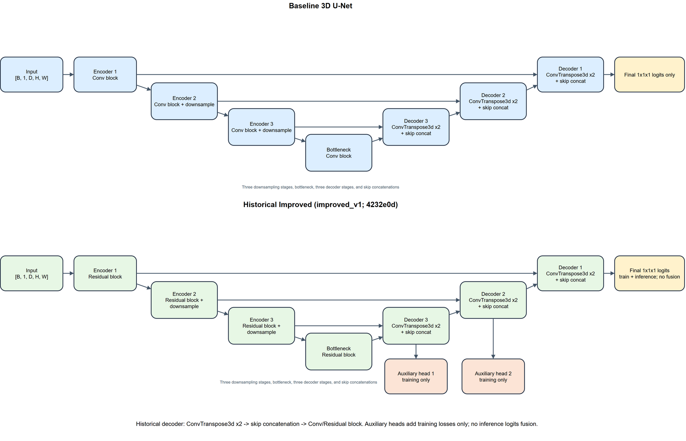
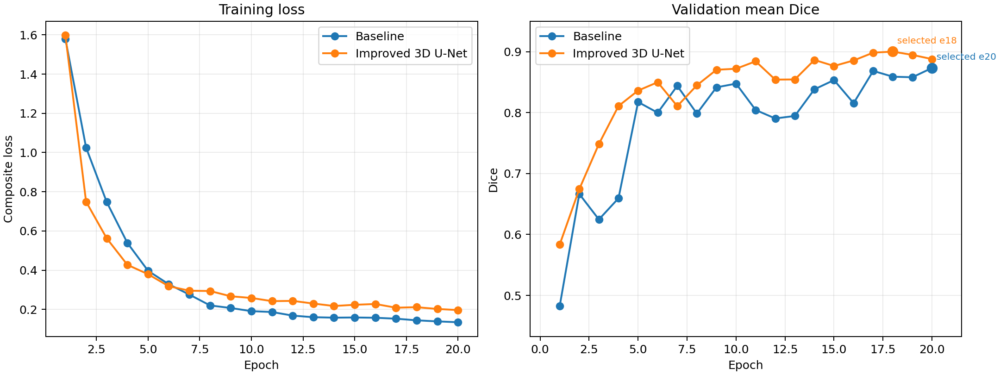
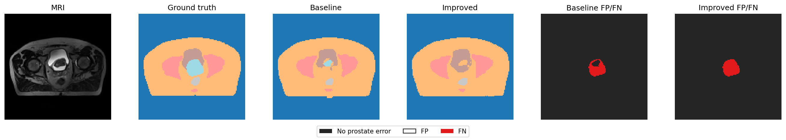
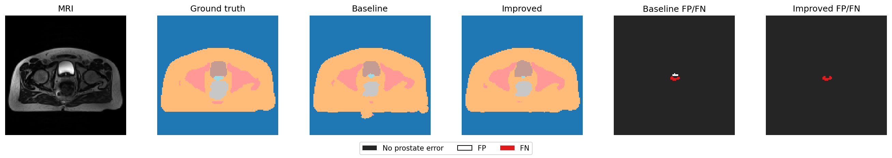
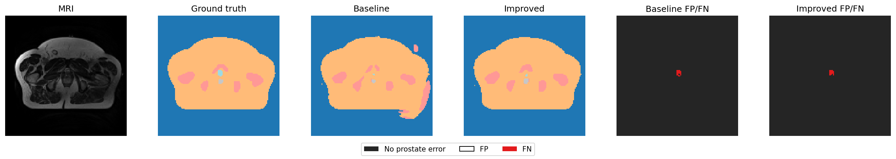
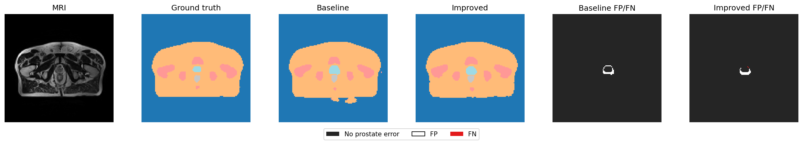
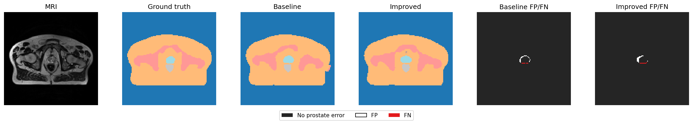
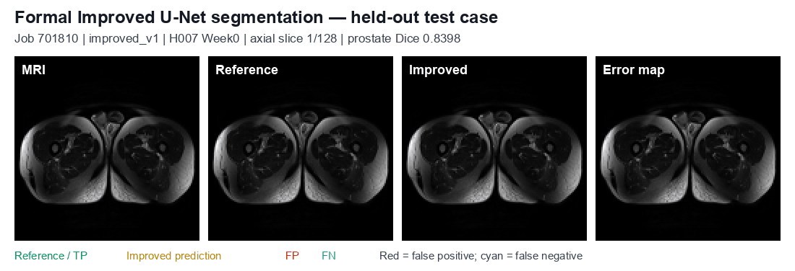

# COMP3710 Assignment 1 — 3D Improved U-Net Segmentation

**Student:** Haoyun Jiang(4910970)
**Option:** Hard — 3D Improved U-Net

## 1. Project overview

This project implements and compares two six-class 3D U-Net architectures for pelvic MRI segmentation using the CSIRO HipMRI dataset:

- **Baseline:** a conventional 3D U-Net with double-convolution blocks.
- **Improved:** a residual 3D U-Net with two training-only deep-supervision heads.

Both models were evaluated with the same patient-disjoint split and matched training and evaluation protocol. Baseline achieved a patient-mean prostate Dice of **0.811548** and Improved achieved **0.813587** across five held-out patients. Both exceed the Hard-option target of `0.70`.

The submission reports segmentation accuracy, computational cost, and prediction errors, with reproducible data auditing, training, and evaluation procedures.



## 2. Assignment objectives and feasibility review

The project objectives are to:

1. implement a reproducible 3D workflow for data audit, preprocessing, training, validation, and full-volume inference;
2. maintain patient-independent training, validation, and test partitions;
3. compare Baseline and Improved 3D U-Net architectures under matched settings;
4. report segmentation metrics, computational cost, and prediction errors; and
5. meet the Hard-option patient-mean prostate Dice target of `0.70`.

The midpoint feasibility review documented the proposed architecture, implementation tests, evaluation criteria, GPU planning, and engineering risks. The review was subsequently checked and accepted by the course tutor. The final work addresses these objectives through dataset auditing, matched formal runs, held-out evaluation, resource measurements, and visual error analysis. The review is available in [HipMRI Feasibility Review v5](assets/HipMRI_Feasibility_Review_v5.pdf).

## 3. Dataset and preprocessing

The project uses the CSIRO [*Labelled weekly MR images of the male pelvis*](https://data.csiro.au/collection/csiro%3A51392) dataset. Raw data are not redistributed. After obtaining the data, use the following layout:

```text
data/
`-- HipMRI_Study_open/
    |-- semantic_MRs/
    `-- semantic_labels_only/
```

The audit pairs `_LFOV` images with `_SEMANTIC` masks. Seed `42` keeps every patient's scans in a single partition.

| Split           |     Patients |         Scans |
| --------------- | -----------: | ------------: |
| Training        |           27 |           146 |
| Validation      |            6 |            46 |
| Test            |            5 |            19 |
| **Total** | **38** | **211** |

Frozen manifest SHA-256:

```text
5457a611c5611f944a26d214a1f325b803dded66f70df5fda3fd009642751a07
```

Images are z-score normalised and resized with trilinear interpolation to `128 x 128 x 128`; masks use nearest-neighbour resizing. Training uses `96 x 96 x 96` patches with a `0.5` probability of sampling a prostate-containing patch. Validation and testing use deterministic resized volumes.

## 4. Model architecture

Both models use three encoder stages, skip connections, channel widths `16 / 32 / 64 / 128`, and six output logits.

| Component                    | Baseline 3D U-Net  | Improved 3D U-Net                     |
| ---------------------------- | ------------------ | ------------------------------------- |
| Main block                   | Double convolution | Residual convolution                  |
| Decoder supervision          | Final output only  | Final output plus two auxiliary heads |
| Auxiliary heads at inference | —                 | Disabled                              |
| Output                       | Six-class logits   | Six-class logits                      |

Training combines weighted cross-entropy and soft Dice loss. The prostate class weight is `4`; all other class weights are `1`. Each Improved auxiliary head contributes `0.25` times the same objective during training. Therefore, the models share the data, preprocessing, training budget, optimiser, and evaluation workflow, while the compared design differences are residual blocks and training-stage auxiliary supervision.

## 5. Repository structure and environment

| File                    | Purpose                                                   |
| ----------------------- | --------------------------------------------------------- |
| `audit.py`            | Validates pairs and writes the patient-disjoint manifest  |
| `dataset.py`          | Loading, preprocessing, crop sampling, and split access   |
| `modules.py`          | Baseline and Improved model definitions                   |
| `train.py`            | Training, validation, checkpoint selection, and summaries |
| `predict.py`          | Full-volume inference, metrics, and visual panels         |
| `compare_failures.py` | Paired Baseline/Improved failure analysis                 |
| `plot_training.py`    | Training-history plotting                                 |
| `requirements.txt`    | Required Python packages                                  |
| `assets/`             | Assignment figures, GIFs, and supporting evidence         |

Generated datasets, manifests, checkpoints, and model outputs are excluded from version control.

## 6. Setup and reproduction

Run the following commands from this directory.

### 6.1 Install dependencies

```bash
python -m pip install -r requirements.txt
```

Python `3.11` and the exact direct package versions in `requirements.txt` were used for local verification. The formal Rangpur jobs used PyTorch `2.13.0+cu130`, whereas the locally verified package is PyTorch `2.11.0` (CUDA `12.8` on the verification machine). The submitted code preserves the model architectures and evaluation procedure used by the formal jobs.

### 6.2 Audit the dataset

```bash
python audit.py data/HipMRI_Study_open --output artifacts/dataset_manifest.json --seed 42
```

The audit checks image-mask pairings, shape and affine consistency, finite values, integer labels, and patient separation.

### 6.3 Train Baseline

```bash
python train.py \
  --manifest artifacts/dataset_manifest.json \
  --data-root data/HipMRI_Study_open \
  --output-dir artifacts/baseline \
  --model baseline \
  --epochs 20 \
  --batch-size 1 \
  --learning-rate 0.001 \
  --base-channels 16 \
  --target-shape 128 128 128 \
  --train-patch-shape 96 96 96 \
  --foreground-patch-probability 0.5 \
  --seed 42 \
  --device cuda \
  --prostate-label 5 \
  --prostate-label-source "CSIRO DOI 10.25919/45T8-P065, BriefDataDescription.txt: 5=Prostate" \
  --prostate-ce-weight 4 \
  --prostate-dice-weight 4 \
  --selection-metric mean_dice \
  --scheduler none
```

### 6.4 Train Improved

Use the Baseline command with a separate output directory and these additional options:

```text
--output-dir artifacts/improved --model improved --architecture-version improved_v1
```

The best checkpoint is selected with validation performance only; the held-out test split is not used for selection or tuning.

### 6.5 Evaluate a selected checkpoint

```bash
python predict.py \
  --checkpoint artifacts/baseline/best.pt \
  --manifest artifacts/dataset_manifest.json \
  --data-root data/HipMRI_Study_open \
  --output-dir artifacts/baseline_test \
  --patch-size 128 128 128 \
  --stride 64 64 64 \
  --device cuda
```

Use a new output directory for each evaluation. `predict.py` reconstructs full volumes using overlap-averaged logits, reports metrics, and writes visual panels.

### 6.6 Reproduce paired failure comparisons

After evaluating both checkpoints, generate the deterministic five-patient comparison set:

```bash
python compare_failures.py \
  --baseline-dir artifacts/baseline_test \
  --improved-dir artifacts/improved_test \
  --output-dir artifacts/paired_failures \
  --max-patients 5
```

The script verifies that both result sets share the manifest, prostate label and source, target shape, patch size, stride, and test-patient set. It ranks scans by the mean whole-volume prostate FP+FN across both models, retains the highest-ranked scan for each patient, and selects the highest paired-error axial slice inside the reference prostate extent. It also ranks the mask-derived apex-side and base-side endpoints among those five reported cases, writes dedicated endpoint panels, and records the selection rules and counts in `failure_selection.json`.

## 7. Experimental protocol

The two formal runs used the frozen manifest, identical preprocessing, seed, batch size, 20-epoch budget, optimiser, class-weighted loss, and inference procedure. The submitted model architectures are unchanged from Rangpur job `701809` (Baseline) and job `701810` (Improved) Both formal jobs completed successfully with Slurm state `COMPLETED` and exit code `0:0`.

The saved checkpoints were independently rerun locally against the same manifest and 19 held-out volumes. Baseline checkpoint produced patient-mean prostate Dice `0.811522`, a difference of `-0.000026` from the formal value. Improved checkpoint produced `0.813634`, a difference of `+0.000047`.

Both independent results remain above the Hard-option target; small numerical differences and inference timing are hardware- and software-environment dependent.

Checkpoints were selected by validation mean Dice before held-out evaluation: epoch 20 for Baseline and epoch 18 for Improved. The held-out test split was used only for final evaluation.



## 8. Results

### 8.1 Patient-level prostate Dice

This primary metric averages prostate Dice across each patient's weekly scans, then weights the five held-out patients equally.

| Test patient   |           Baseline |           Improved |          Difference |
| -------------- | -----------------: | -----------------: | ------------------: |
| B037           |           0.736256 |           0.674195 |           -0.062061 |
| H007           |           0.781378 |           0.839755 |           +0.058377 |
| K042           |           0.887015 |           0.878500 |           -0.008516 |
| L011           |           0.781136 |           0.795553 |           +0.014417 |
| M013           |           0.871957 |           0.879931 |           +0.007974 |
| **Mean** | **0.811548** | **0.813587** | **+0.002038** |

Both models meet the `0.70` target. Improved is higher for three patients and lower for two; the mean advantage is small rather than consistent for every patient.

### 8.2 Per-class Dice and IoU

The following values are scan means across the 19 held-out volumes. Labels 1–5 reproduce the reported test metrics. Background was independently recomputed from saved prediction tensors using the same per-scan averaging rule and is shown separately because its dominant score can obscure anatomical errors.

| Class      | Baseline Dice | Baseline IoU | Improved Dice | Improved IoU |
| ---------- | ------------: | -----------: | ------------: | -----------: |
| Background |      0.982804 |     0.966255 |      0.994107 |     0.988292 |
| Body       |      0.958148 |     0.919909 |      0.977807 |     0.956600 |
| Bones      |      0.859094 |     0.753894 |      0.904555 |     0.825973 |
| Bladder    |      0.957028 |     0.917811 |      0.960610 |     0.924386 |
| Rectum     |      0.852767 |     0.747437 |      0.861629 |     0.758714 |
| Prostate   |      0.822599 |     0.702348 |      0.831385 |     0.715546 |

Improved is higher for every scan-mean class metric. This does not contradict the small patient-mean difference, because the two summaries use different aggregation rules.

### 8.3 Computational cost

Peak memory is allocated GPU memory. Inference time is cumulative model-execution time per preprocessed held-out patient.

| Model    | Parameters | Peak train VRAM | Peak inference VRAM | Training time | Mean inference / patient |
| -------- | ---------: | --------------: | ------------------: | ------------: | -----------------------: |
| Baseline |  1,400,646 |       977.6 MiB |         1,047.4 MiB |     1,369.1 s |               0.248920 s |
| Improved |  1,423,106 |     1,193.4 MiB |         1,047.5 MiB |     1,388.2 s |               0.249449 s |

Improved adds 22,460 parameters and uses approximately 22% more peak training memory. Inference memory and measured model-execution time are effectively unchanged.

## 9. Prediction and error analysis

Five cases were selected to cover all five held-out patients. Scans were ranked by the mean whole-volume prostate FP+FN across both models, and the highest-ranked scan from each patient was retained. Each panel compares the same MRI, reference mask and axial slice for Baseline and Improved. Four panels use the maximum paired-error slice inside the reference prostate extent. The K042 panel instead uses its mask-derived apex-side endpoint so that the five-case set directly covers both an apex-side and a base-side boundary. White denotes false-positive prostate voxels and red denotes false negatives.

| Case       | Baseline FP / FN | Improved FP / FN |
| ---------- | ---------------: | ---------------: |
| B037 Week0 |      393 / 2,495 |      166 / 3,123 |
| L011 Week2 |         894 / 68 |        738 / 159 |
| K042 Week0 |        432 / 439 |        208 / 673 |
| M013 Week0 |         581 / 85 |        407 / 171 |
| H007 Week0 |        432 / 155 |        121 / 245 |

- **B037 Week0:** Improved removes 227 FP but adds 628 FN. The severe loss of reference coverage makes this the clearest regression.
- **L011 Week2:** Improved removes 156 FP but adds 91 FN. Reduced outward extension is accompanied by greater omission.
- **K042 Week0:** Across the full volume, Improved removes 224 FP but adds 234 FN. The displayed apex-side endpoint has 28 FN for Baseline and 26 FN for Improved, with no prostate FP for either model on that slice. The small cross-section remains almost entirely missed by both models.
- **M013 Week0:** Improved removes 174 FP and adds 86 FN. Total error falls, but reference-tissue coverage is less complete.
- **H007 Week0:** Improved removes 311 FP and adds 90 FN. The strong reduction in excess contour comes with lower recall.











The repeated direction across all five patients indicates a systematic shift toward more conservative contours rather than an isolated patient effect. B037 Week0 is especially important: a modest FP reduction accompanies substantially more missed prostate. H007 Week0 and M013 Week0 reduce total error, but they also lose reference-tissue coverage. Small prostate cross-sections, partial-volume effects, low soft-tissue contrast and resizing are plausible contributors; this experiment did not isolate their individual effects.

The source NIfTI affines use L/P/S orientation, and tensor depth increases in the superior direction after loading. For this analysis, the first non-empty reference-prostate slice is operationally defined as the **apex-side endpoint**, and the last non-empty slice as the **base-side endpoint**. These are mask-derived boundary locations, not independently annotated clinical base/apex landmarks.

Following the course emphasis on prostate-base failures, H007 Week0 is the primary endpoint autopsy because its displayed slice reaches the mask-derived base-side boundary. K042 Week0 provides a supplementary apex-side comparison. Both cases are selected deterministically from the same five reported failure cases by maximum paired error at the relevant endpoint:

| Endpoint  | Case       | Slice | Baseline FP / FN | Improved FP / FN |
| --------- | ---------- | ----: | ---------------: | ---------------: |
| Base-side | H007 Week0 |    72 |          13 / 30 |           0 / 33 |
| Apex-side | K042 Week0 |    51 |           0 / 28 |           0 / 26 |

The H007 image already coincides with the base-side endpoint. Baseline retains more reference tissue there (`30` FN versus `33`) but adds `13` FP, whereas Improved removes those FP at the cost of three additional FN. This is the main boundary trade-off in the base-focused review. The K042 image shows the supplementary apex-side endpoint, where both models have zero FP but miss most of the small reference cross-section (`28` and `26` FN). These results show that acceptable whole-volume Dice does not guarantee reliable terminal-slice coverage.

The following positions locate the five displayed slices within each resized reference prostate extent.

| Case       | Inferior / superior reference slice | Displayed slice | Relative position |
| ---------- | ----------------------------------: | --------------: | ----------------: |
| B037 Week0 |                             42 / 79 |              70 |             0.757 |
| L011 Week2 |                             62 / 88 |              70 |             0.308 |
| K042 Week0 |                             51 / 82 |              51 |             0.000 |
| M013 Week0 |                             46 / 69 |              65 |             0.826 |
| H007 Week0 |                             47 / 72 |              72 |             1.000 |

H007 Week0 reaches the superior/base-side endpoint and is the primary terminal-slice failure case. K042 Week0 reaches the inferior/apex-side endpoint as supplementary evidence; the other displayed panels lie inside the reference extent.

Baseline produced multiple prostate components in `6/19` held-out scans; Improved produced one component in every scan. Connectivity is an observation rather than proof of correctness: a connected contour can still omit clinically important reference tissue.

For an operational contour-drafting assistant, prostate-base slices require mandatory specialist review. The same safeguard should be extended to apex-side slices, other small reference cross-sections, scans with high prostate FN, and scans with disconnected predictions. Any apparent leakage toward bladder or rectum also requires manual inspection because the present evaluation reports overlap and connectivity but does not measure surface distance to those organs. These safeguards are necessary even when the whole-volume Dice exceeds the course target.

## 10. Formal Improved segmentation animation

The animation below visualises the formal Improved model (`improved_v1`, Rangpur job `701810`) on the held-out case `H007_Week0`. It moves through all 128 axial slices of the resized volume and shows the MRI, reference prostate, Improved prediction, and a prostate-specific error map. Green denotes reference or true-positive prostate voxels, yellow denotes the Improved prediction, red denotes false positives, and cyan denotes false negatives.



For this case, the prostate Dice is `0.839755`. The animation is a qualitative view of one held-out case and complements the aggregate results and five-patient error analysis above.

## 11. Conclusion and limitations

Both architectures were implemented, trained, and evaluated under the same patient-disjoint protocol, and both exceed the Hard-option target. Improved achieved a slightly higher patient-mean prostate Dice (`0.813587` versus `0.811548`) as well as higher scan-mean Dice and IoU for each reported class. The patient-level gain is only `0.002038`, varies by patient, and includes a `0.062061` regression for B037. Improved also required approximately 22% more peak training GPU memory, while measured inference time was nearly unchanged.

The evidence does not justify replacing Baseline as the default operational drafting model. Improved is a useful research candidate because it removes disconnected prostate components and slightly raises aggregate overlap, but the gain is small, training memory is higher, and the B037 regression shows weaker worst-case reliability. Baseline is therefore the more conservative default for this prototype.

## 12. References

1. Çiçek et al., [3D U-Net: Learning Dense Volumetric Segmentation from Sparse Annotation](https://arxiv.org/abs/1606.06650), 2016.
2. Isensee et al., [Brain Tumor Segmentation and Radiomics Survival Prediction: Contribution to the BRATS 2017 Challenge](https://arxiv.org/abs/1802.10508), 2018. Architectural inspiration only.
3. CSIRO, [Labelled weekly MR images of the male pelvis](https://data.csiro.au/collection/csiro%3A51392), DOI [10.25919/45T8-P065](https://doi.org/10.25919/45T8-P065).

## 13. Artificial Intelligence Usage Disclosure

**AI tools used:** OpenAI ChatGPT and Codex.

Generative AI tools were used to provide general technical guidance and assist with selected software development and documentation tasks during this project.

The main areas of assistance included:

- **General guidance:** Clarifying project requirements, discussing preliminary implementation ideas and organising development tasks.
- **Project organisation:** Assisting with the initial file structure and documentation layout.
- **Testing:** Assisting with drafting test files, preparing test cases and troubleshooting testing-related issues.
- **SLURM scripts:** Assisting with writing and adjusting SLURM job submission scripts for GPU experiments on the Rangpur cluster.
- **Documentation:** Assisting with organising and refining README content, Markdown formatting and technical descriptions.

AI-generated suggestions and code were reviewed and adjusted as needed. Relevant scripts and tests were checked through local execution or GPU job outputs.

The project implementation, experimental results and final submission remain the responsibility of the author.
